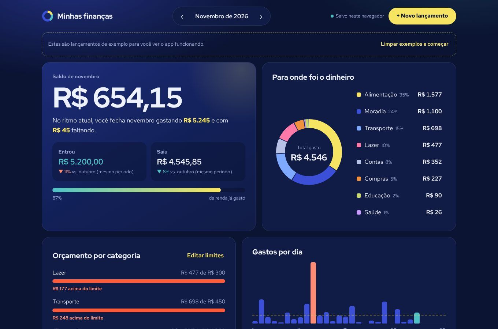
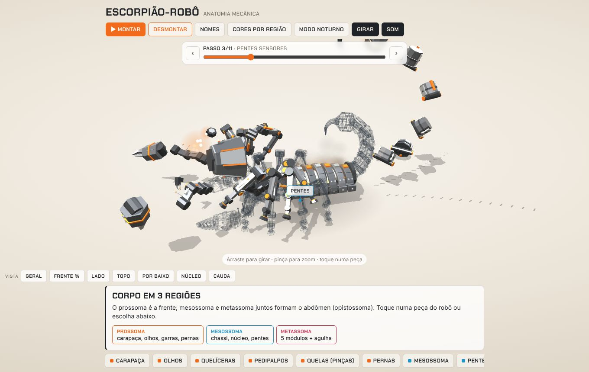
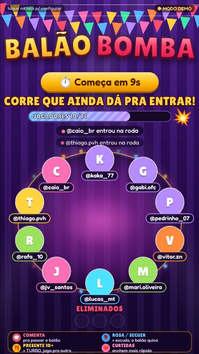

<picture>
  <source media="(prefers-color-scheme: dark)" srcset="assets/banner-dark.svg">
  
</picture>

  
  
  

Sou de Porto Velho (RO), estudante de Engenharia da Computação na UniSapiens e técnico em Eletrotécnica pelo SENAI. Fui jovem aprendiz na Energisa, onde fiz aplicativos em Power Apps e automações com Python e n8n. Hoje atendo comércios e empresas locais como freelancer: sites, sistemas web, catálogos, bots de WhatsApp e automações.

## Experiência

**Consultor de tecnologia (freelancer)**, Porto Velho, 2024 até hoje 
Sites, sistemas web e catálogos para comércios locais, ligados ao WhatsApp e às vendas. Bots de WhatsApp e automações com n8n para tirar trabalho manual do atendimento.

**Jovem aprendiz, DCMD, Grupo Energisa**, out/2024 a fev/2026 
Aplicativos em Power Apps para receber e acompanhar projetos elétricos e padronizar formulários. Automação de rotinas e tratamento de dados com Python e n8n. Recebi reconhecimento interno pelas melhorias nos formulários e pelo aplicativo de gestão de projetos elétricos.

## Projetos em destaque

### [agentsec](https://github.com/Kenzokishi/agentsec)

Scanner de segurança para aplicações com IA. Ele testa injeção de prompt, vazamento do system prompt, roubo de segredos e abuso de ferramentas, e liga cada falha ao OWASP Top 10 para LLM. Vem com um agente vulnerável de exemplo, então dá para rodar sem chave de API.

`TypeScript` `Node 20` `GitHub Actions` `OWASP LLM Top 10`

### [chamados-api](https://github.com/Kenzokishi/chamados-api)

API REST da central de chamados que atende empresas pelo WhatsApp: cadastro com validação de CNPJ, abertura de chamado com protocolo, fluxo de status com histórico e relatório. Documentada no Swagger, com 16 testes contra PostgreSQL de verdade e CI no GitHub Actions. O bot no n8n chama esta API.

`Node.js` `TypeScript` `Express` `PostgreSQL` `Docker` `OpenAPI`

### [analise-vendas-powerbi](https://github.com/Kenzokishi/analise-vendas-powerbi)

Análise de vendas de ponta a ponta de uma distribuidora fictícia de materiais de construção com 6 lojas em Rondônia: base gerada em Python, modelo em estrela, consultas SQL e relatório no Power BI com medidas DAX. A análise mostra que o faturamento cresceu 19%, mas a margem ficou parada em 20,4% porque o desconto no aço dobrou.

`Power BI` `DAX` `SQL` `Python`

## Projetos para clientes

Quando o projeto tem dado de cliente, o código fica privado.

| Projeto | O que faz | Stack | Situação |
| --- | --- | --- | --- |
| **Central de chamados no WhatsApp** | Cerca de 50 empresas cadastradas abrem chamados pelo WhatsApp. O bot identifica cada uma pelo código ou CNPJ e registra o pedido. A API está em [chamados-api](https://github.com/Kenzokishi/chamados-api). | n8n, WAHA, Node.js, PostgreSQL, Docker | Em andamento |
| **Filtro do WhatsApp de um diretor** | Organiza um WhatsApp Business que recebe de 5 a 20 mensagens por minuto: separa o que é urgente, manda resumos e sugere horários de reunião. | n8n, WhatsApp Cloud API, LLM | Em andamento |
| **[EuroAdega](https://github.com/Kenzokishi/euroadega)** | Loja online de uma adega, com carrinho que fecha pelo WhatsApp e painel de estoque, vendas e finanças. [Demo](https://kenzokishi.github.io/euroadega/) | HTML, CSS, JavaScript | Em andamento |
| **[Controle de briques](https://github.com/Kenzokishi/controle-de-briques)** | Compra, venda, troca e desmonte de kits para um revendedor de peças de computador, com o lucro real de cada negócio. [Demo](https://kenzokishi.github.io/controle-de-briques/) | HTML, CSS, JavaScript | Em uso |
| **[Studio F7](https://github.com/Kenzokishi/studio-f7-site)** | Site de um estúdio de vídeo e motion design, com painel para o cliente trocar portfólio, marcas e fotos. [Portfólio](https://kenzokishi.github.io/studio-f7-site/) | React, TypeScript, Supabase | Entregue |
| **[Guttoneres Engenharia](https://github.com/Kenzokishi/guttoneres-site)** | Site institucional de uma empresa de engenharia civil e elétrica de Porto Velho, com páginas de serviço, obras, equipe e compliance. [Nova versão](https://kenzokishi.github.io/guttoneres-site/) | HTML, CSS, JavaScript | [No ar](https://guttoneres.com.br) |

## Projetos próprios

| Projeto | O que faz | Situação |
| --- | --- | --- |
| **Vesálio** | Atlas 3D de anatomia humana para estudantes de medicina, focado em treino para prova prática. | Em desenvolvimento |
| **[Atende AI](https://github.com/Kenzokishi/atende-ai-site)** | Landing page do meu serviço de atendimento com IA no WhatsApp, com simulação de conversa e calculadora de retorno (Next.js). [Site](https://kenzokishi.github.io/atende-ai-site/) | No ar |
| **[Balão Bomba](https://github.com/Kenzokishi/balao-bomba)** | Jogo de batata quente que roda sozinho nas lives do TikTok. Comentários, curtidas e presentes mudam o jogo em tempo real. [Demo](https://kenzokishi.github.io/balao-bomba/) | No ar |
| **[WhatsApp AI bot](https://github.com/Kenzokishi/whatsapp-ai-bot)** | Bot de atendimento sobre a Evolution API (Docker, Postgres e Redis) com respostas do Gemini e histórico por contato. | Código aberto |
| **[Escorpião-robô 3D](https://github.com/Kenzokishi/escorpiao-robo-3d)** | Modelo 3D em Three.js que ensina a anatomia do escorpião montando um robô em 11 passos. [Demo](https://kenzokishi.github.io/escorpiao-robo-3d/) | No ar |
| **[Minhas finanças](https://github.com/Kenzokishi/minhas-financas)** | Controle de gastos pessoal: projeção do mês, limite por categoria e gastos por dia. [Demo](https://kenzokishi.github.io/minhas-financas/) | No ar |

## Galeria

<table>
<tr>
<td width="50%" valign="top">

<b><a href="https://github.com/Kenzokishi/euroadega">EuroAdega</a></b>: loja de bebidas com confirmação de idade, carrinho que fecha pelo WhatsApp e painel do dono.
</td>
<td width="50%" valign="top">

<b><a href="https://github.com/Kenzokishi/minhas-financas">Minhas finanças</a></b>: projeção do mês, orçamento por categoria, gastos por dia e exportação em CSV.
</td>
</tr>
<tr>
<td width="50%" valign="top">

<b><a href="https://github.com/Kenzokishi/escorpiao-robo-3d">Escorpião-robô 3D</a></b>: modelo em Three.js feito todo em código, que se monta passo a passo.
</td>
<td width="50%" valign="top" align="center">
 
<b><a href="https://github.com/Kenzokishi/balao-bomba">Balão Bomba</a></b>: jogo automático para lives do TikTok, controlado pela plateia.
</td>
</tr>
</table>

## Ferramentas

Também: SQL, APIs REST, Excel avançado, AutoCAD e GIS, e fundamentos de redes (TCP/IP, IPv4/IPv6, Ethernet).

## Formação

- **Engenharia da Computação**, Faculdade UniSapiens: cursando (2024 a 2028)
- **Técnico em Eletrotécnica**, SENAI CETEM: concluído em fev/2026

## Cursos

- **CCNA 2: Switching, Routing, and Wireless Essentials**, Cisco Networking Academy: cursando (jul a dez/2026)
- **CCNA 1: Introduction to Networks**, Cisco Networking Academy: turma de fev a jul/2026
- **CS50x: Introduction to Computer Science**, Harvard: estudo por conta própria, pelas aulas abertas
- **Hashtag Treinamentos**: APIs de Inteligência Artificial (certificado emitido); Supabase Impressionador e Inteligência Artificial Impressionador (em andamento)

Inglês intermediário. Participei do Web Summit Rio 2026.

## Contato

Procuro vaga em desenvolvimento, automação ou dados. Fale comigo pelo [LinkedIn](https://www.linkedin.com/in/pedro-kenzo-sales-kishi-bb4897213/) ou pelo e-mail **pedrokishi@gmail.com**.
